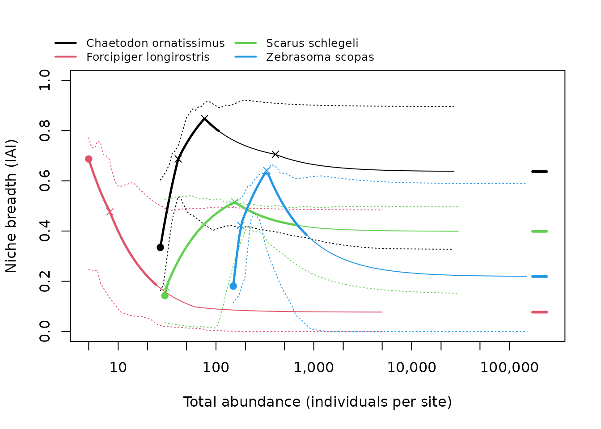

# Get started with isoniche

**isoniche** estimates the habitat niche breadth of species from counts
in several habitats, corrected for abundance. Classic indices (Levins’
B, 1 - Gini of habitat proportions, Shannon…) make rare species look
like specialists: when a species is rare, its few individuals sit in its
preferred habitat; when it is abundant, it spills into others. isoniche
uses *isodars*, the relationships between a species’ densities in pairs
of habitats, to predict where individuals settle at any total abundance,
and reports two numbers per species:

- **density-independent (DI) niche breadth**: how widely the species
  uses habitats when it is rare, at the *spillover abundance* where it
  first occupies all the habitats it uses;
- **density-dependent (DD) niche breadth**: how widely it uses habitats
  when it is abundant.

Both are on a 0-1 scale (0: one habitat only; 1: equal use of all
habitats) and, unlike classic indices, they can be compared among
species that differ in abundance.

This vignette walks through a complete analysis. The other vignettes go
into more detail:

- [`vignette("data-preparation")`](https://itai811.github.io/isoniche/articles/data-preparation.md):
  data formats, effort, choosing habitats, absent habitats, grouping
  sites;
- [`vignette("diagnostics")`](https://itai811.github.io/isoniche/articles/diagnostics.md):
  when to trust an estimate and what to do when a species is flagged;
- [`vignette("method")`](https://itai811.github.io/isoniche/articles/method.md):
  how the method works (Granot, Dubiner & Belmaker 2026).

## What you need

Counts of each species in two or more habitats, in many *replicates*:
sites, or repeated surveys of the same site. Replicates should span a
range of abundances, because isodars are estimated from how abundance in
one habitat changes with abundance in another. As a rule of thumb, aim
for at least 10 replicates per species, most of them sampling every
habitat.

``` r

library(isoniche)
```

## 1. Your data

isoniche works on data in long format, one row per species x site x
habitat, with the number of individuals counted. A habitat not sampled
at a site simply has no row; a habitat sampled where the species was not
found should have a row with a count of 0.

The package includes counts of 325 reef fish species in three habitats
(barrier reef, fringing reef, outer slope) at 13 sites around Moorea,
French Polynesia:

``` r

head(moorea_fish)
#>                     species      site       habitat abundance
#> 1 Abudefduf septemfasciatus Afareaitu  barrier_reef         0
#> 2 Abudefduf septemfasciatus Afareaitu fringing_reef         1
#> 3 Abudefduf septemfasciatus Afareaitu   outer_slope         0
#> 4 Abudefduf septemfasciatus      Aroa  barrier_reef         8
#> 5 Abudefduf septemfasciatus      Aroa fringing_reef         7
#> 6 Abudefduf septemfasciatus      Aroa   outer_slope         0
```

If your data are a community matrix (samples x species, as used by
**vegan**) with a separate table describing each sample, convert them
with
[`community_to_long()`](https://itai811.github.io/isoniche/reference/community_to_long.md):

``` r

comm <- matrix(c(12, 0, 3,
                  8, 2, 0,
                  0, 5, 9),
               nrow = 3, byrow = TRUE,
               dimnames = list(NULL, c("sp_a", "sp_b", "sp_c")))
samples <- data.frame(site = c("north", "north", "south"),
                      habitat = c("reef", "lagoon", "reef"))
community_to_long(comm, samples, site = "site", habitat = "habitat")
#> # A tibble: 9 × 5
#>   species site  habitat abundance effort
#>   <chr>   <chr> <chr>       <dbl>  <dbl>
#> 1 sp_a    north lagoon          8      1
#> 2 sp_a    north reef           12      1
#> 3 sp_a    south reef            0      1
#> 4 sp_b    north lagoon          2      1
#> 5 sp_b    north reef            0      1
#> 6 sp_b    south reef            5      1
#> 7 sp_c    north lagoon          0      1
#> 8 sp_c    north reef            3      1
#> 9 sp_c    south reef            9      1
```

Several samples from the same site and habitat are pooled, and their
effort (here the number of samples) is summed into an `effort` column.
If samples differ in effort, for example in transect area, give that
column to
[`community_to_long()`](https://itai811.github.io/isoniche/reference/community_to_long.md)
and pass it on as `effort =` to the functions below; set
`reference_effort` to a natural unit such as one standard transect. See
[`vignette("data-preparation")`](https://itai811.github.io/isoniche/articles/data-preparation.md).

## 2. Check coverage

Before estimating anything, check how well each species was sampled:

``` r

cov <- check_coverage(moorea_fish, species = "species", site = "site",
                      habitat = "habitat", abundance = "abundance")
cov[cov$species == "Chaetodon ornatissimus", ]
#> # A tibble: 3 × 8
#>   species     habitat n_sites n_complete n_sampled n_occupied total_count status
#>   <chr>       <chr>     <int>      <int>     <dbl>      <dbl>       <dbl> <chr> 
#> 1 Chaetodon … barrie…      13         13        13         13         136 used  
#> 2 Chaetodon … fringi…      13         13        13         10         155 used  
#> 3 Chaetodon … outer_…      13         13        13         13         301 used
table(cov$status)
#> 
#>       absent undersampled         used 
#>          148          177          650
```

For each species and habitat, `n_sites` is the number of sites where the
species was recorded, `n_occupied` the number where it was found in this
habitat, and `status` says how the habitat will be treated: `"used"`,
`"absent"` (never found in it although it was sampled at several sites
where the species occurred; it counts as 0 and lowers niche breadth) or
`"undersampled"` (no records, but too few sites to tell).

## 3. Estimate niche breadth

We analyse 12 species that were recorded at almost every site, in every
habitat.
[`niche_breadth()`](https://itai811.github.io/isoniche/reference/niche_breadth.md)
fits the isodars of every species, computes DI and DD niche breadth and
the spillover abundance, and gives bootstrap confidence intervals by
resampling whole sites (`n_boot` replicates; we use 99 to keep this
vignette fast, but use 999 or more for publication):

``` r

species <- c("Balistapus undulatus", "Chaetodon ornatissimus",
             "Chaetodon ulietensis", "Ctenochaetus binotatus",
             "Dascyllus flavicaudus", "Forcipiger longirostris",
             "Halichoeres marginatus", "Heniochus chrysostomus",
             "Parupeneus multifasciatus", "Sargocentron microstoma",
             "Scarus schlegeli", "Zebrasoma scopas")
fish <- moorea_fish[moorea_fish$species %in% species, ]

nb <- niche_breadth(fish, species = "species", site = "site",
                    habitat = "habitat", abundance = "abundance",
                    n_boot = 99, seed = 1)
nb
#> # A tibble: 12 × 35
#>    species      method n_sites nb_di nb_di_lower nb_di_upper spillover_abundance
#>    <chr>        <chr>    <int> <dbl>       <dbl>       <dbl>               <dbl>
#>  1 Balistapus … pairw…      13 0.115      0.0933       0.547                  36
#>  2 Chaetodon o… pairw…      13 0.335      0.200        0.457                  27
#>  3 Chaetodon u… pairw…      12 0.534      0.338        0.784                  14
#>  4 Ctenochaetu… pairw…      11 0.543      0.332        0.957                  11
#>  5 Dascyllus f… pairw…      13 0.211      0.0730       0.489                  60
#>  6 Forcipiger … pairw…      13 0.687      0.0930       0.937                   5
#>  7 Halichoeres… pairw…      13 0.692      0.480        0.764                  10
#>  8 Heniochus c… pairw…      13 0.337      0.133        0.596                  14
#>  9 Parupeneus … pairw…      13 0.225      0.174        0.551                  89
#> 10 Sargocentro… pairw…      13 0.609      0.508        0.787                  13
#> 11 Scarus schl… pairw…      13 0.143      0.0573       0.625                  30
#> 12 Zebrasoma s… pairw…      13 0.181      0.117        0.396                 150
#> # ℹ 28 more variables: spillover_lower <dbl>, spillover_upper <dbl>,
#> #   nb_dd <dbl>, nb_dd_lower <dbl>, nb_dd_upper <dbl>, dependent_at <dbl>,
#> #   var_explained <dbl>, intercept_p <dbl>, absent <chr>, abandoned <chr>,
#> #   reversals <list>, n_boot_valid <int>, flags <chr>, flag_few_sites <lgl>,
#> #   flag_few_pair_sites <lgl>, flag_low_abundance <lgl>,
#> #   flag_di_extrapolation <lgl>, flag_dd_extrapolation <lgl>,
#> #   flag_abandoned <lgl>, flag_reversal <lgl>, flag_poor_fit <lgl>, …
#> 7 species flagged (not counting abandoned habitats or reversals); see summary()
#> Abundances are per site (equal effort in every site and habitat).
```

The result is a table with one row per species. The main columns:

- `nb_di` (with `nb_di_lower`, `nb_di_upper`): DI niche breadth and its
  confidence interval;
- `spillover_abundance`: the total abundance (individuals per sampling
  unit, here per site) at which the species first occupies every habitat
  it uses; DI niche breadth is measured there;
- `nb_dd`: DD niche breadth, the limit at high abundance;
- `flags`: diagnostics raised for the species.

``` r

res <- as.data.frame(nb[c("species", "nb_di", "nb_di_lower", "nb_di_upper",
                          "spillover_abundance", "nb_dd", "nb_dd_lower",
                          "nb_dd_upper")])
res[-1] <- round(res[-1], 2)
res[order(-res$nb_di), ]
#>                      species nb_di nb_di_lower nb_di_upper spillover_abundance
#> 6    Forcipiger longirostris  0.69        0.09        0.94                   5
#> 7     Halichoeres marginatus  0.69        0.48        0.76                  10
#> 10   Sargocentron microstoma  0.61        0.51        0.79                  13
#> 4     Ctenochaetus binotatus  0.54        0.33        0.96                  11
#> 3       Chaetodon ulietensis  0.53        0.34        0.78                  14
#> 8     Heniochus chrysostomus  0.34        0.13        0.60                  14
#> 2     Chaetodon ornatissimus  0.33        0.20        0.46                  27
#> 9  Parupeneus multifasciatus  0.23        0.17        0.55                  89
#> 5      Dascyllus flavicaudus  0.21        0.07        0.49                  60
#> 12          Zebrasoma scopas  0.18        0.12        0.40                 150
#> 11          Scarus schlegeli  0.14        0.06        0.62                  30
#> 1       Balistapus undulatus  0.12        0.09        0.55                  36
#>    nb_dd nb_dd_lower nb_dd_upper
#> 6   0.08        0.00        0.58
#> 7   0.62        0.00        0.84
#> 10  0.00        0.00        0.19
#> 4   0.11        0.00        0.45
#> 3   0.48        0.00        0.49
#> 8   0.11        0.00        0.25
#> 2   0.64        0.29        0.89
#> 9   0.28        0.01        0.54
#> 5   0.01        0.00        0.06
#> 12  0.22        0.00        0.43
#> 11  0.40        0.30        0.49
#> 1   0.40        0.02        0.56
```

A species with high DI niche breadth uses several habitats even when
rare: its isodar intercepts are small, so it has no strongly preferred
habitat. A species with high DD niche breadth spreads evenly among
habitats when abundant: its isodar slopes are close to 1, so its
habitats fill at similar rates. The two need not agree; a species can be
a specialist when rare and a generalist when abundant, or the reverse.

## 4. Check the diagnostics

Every species gets logical `flag_*` columns.
[`summary()`](https://rdrr.io/r/base/summary.html) counts them and
explains what to do about each:

``` r

summary(nb)
#> Niche breadth for 12 species
#>   DD niche breadth at: asymptote; bootstrap replicates: 99
#>   with DI and DD estimates: 12
#>   without warning flags:    5
#> 
#> Estimates (quartiles):
#>                       min    q25 median    q75     max
#> nb_di               0.115  0.204  0.336  0.559   0.692
#> spillover_abundance 5.000 12.500 20.500 42.000 150.000
#> nb_dd               0.000  0.100  0.249  0.424   0.637
#> 
#> Flags raised (species):
#>   unstable_bootstrap     7  many bootstrap replicates failed, or a confidence interval is very wide
#>                             -> increase n_boot; if still wide, the data cannot resolve niche breadth
#>   intercept_noise        1  isodar intercepts do not differ from sampling noise
#>                             -> no evidence that niche breadth changes with abundance; report DD niche breadth
#>   reversal              12  habitats change rank along the niche breadth curve
#>                             -> informational: compare species at a stated abundance (see iai_curve())
#>   abandoned              6  a used habitat is abandoned at high density
#>                             -> informational: the habitat counts for DI but not for DD niche breadth
#> 
#> See vignette("diagnostics") for details. Thresholds are set with niche_breadth(diagnostics = ).
```

`reversal` and `abandoned` describe the species rather than a problem:
the ranking of habitats changes with abundance, or a habitat used when
the species is rare is left empty when it is abundant. The others are
warnings. Here most species are flagged `unstable_bootstrap`: with only
13 sites, the confidence intervals are wide (see the table above), and
several DD intervals reach 0. This is a property of the data, not of the
method: niche breadth is estimated from the spread of densities across
sites, and 13 sites constrain it only loosely. More replicates narrow
the intervals.

To keep only species without warnings:

``` r

s <- summary(nb)
clean <- nb[nb$species %in% s$clean, ]
nrow(clean)
#> [1] 5
```

See
[`vignette("diagnostics")`](https://itai811.github.io/isoniche/articles/diagnostics.md)
for each flag.

## 5. Niche breadth across abundances

DI and DD niche breadth are the two ends of a curve: niche breadth as a
function of total abundance, much like a rarefaction curve.
[`iai_curve()`](https://itai811.github.io/isoniche/reference/iai_curve.md)
computes it, and
[`plot()`](https://rdrr.io/r/graphics/plot.default.html) draws it (here
for four species):

``` r

curves <- iai_curve(nb, n_boot = 49, seed = 1)
plot(curves, species = c("Chaetodon ornatissimus", "Forcipiger longirostris",
                         "Scarus schlegeli", "Zebrasoma scopas"))
```



Each curve starts at the species’ spillover abundance (filled point, DI
niche breadth) and approaches DD niche breadth (dash on the right);
dotted lines are the bootstrap band and crosses mark preference
reversals.

## 6. Compare species

Because the estimates do not depend on how abundant a species happened
to be, they can be compared among species, or related to traits. Ranks
by DI and by DD niche breadth can differ:

``` r

plot(nb$nb_di, nb$nb_dd, pch = 19, xlim = c(0, 1), ylim = c(0, 1),
     xlab = "DI niche breadth", ylab = "DD niche breadth")
abline(0, 1, lty = 2)
```


``` r

cor(nb$nb_di, nb$nb_dd, method = "spearman")
#> [1] -0.1608392
```

Where two species’ curves cross, which one is the broader generalist
depends on the abundance at which they are compared. These crossings are
listed in a table:

``` r

head(attr(curves, "crossings"))
#> # A tibble: 6 × 4
#>   species_1            species_2                 total_abundance niche_breadth
#>   <chr>                <chr>                               <dbl>         <dbl>
#> 1 Balistapus undulatus Ctenochaetus binotatus               65.4         0.263
#> 2 Balistapus undulatus Dascyllus flavicaudus               157.          0.345
#> 3 Balistapus undulatus Forcipiger longirostris              37.6         0.134
#> 4 Balistapus undulatus Heniochus chrysostomus               71.4         0.274
#> 5 Balistapus undulatus Parupeneus multifasciatus            95.1         0.307
#> 6 Balistapus undulatus Parupeneus multifasciatus           710.          0.391
```

## 7. Reporting

When reporting results, state:

- the habitats included, and which were treated as absent for each
  species;
- the sampling unit of abundance (`reference_effort`; see
  [`vignette("data-preparation")`](https://itai811.github.io/isoniche/articles/data-preparation.md)):
  DI niche breadth and spillover abundance depend on it, DD niche
  breadth does not;
- the isodar method (`dim`, by default pairwise isodars with
  inverse-variance weights) and where DD niche breadth was evaluated
  (`dependent_at`, by default the asymptote);
- the number of bootstrap replicates and the diagnostic thresholds, and
  how flagged species were handled;
- the package version (`packageVersion("isoniche")`) and the paper
  (`citation("isoniche")`).

## References

Granot, I., Dubiner, S. & Belmaker, J. (2026). Why abundance-based
indices of niche breadth are biased, and what can be done to improve
them. *Ecology Letters* (in revision). Itai Granot and Shahar Dubiner
contributed equally.
