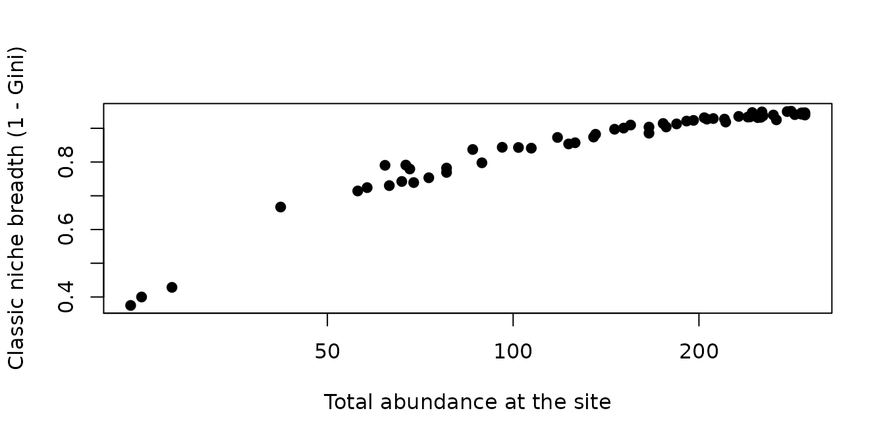
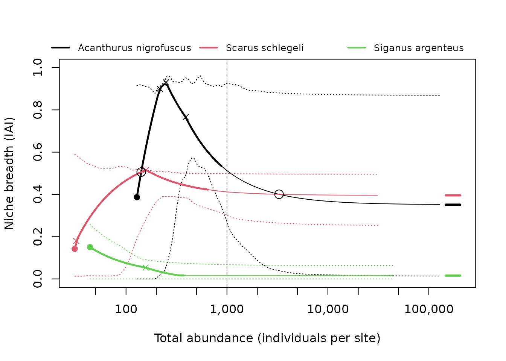
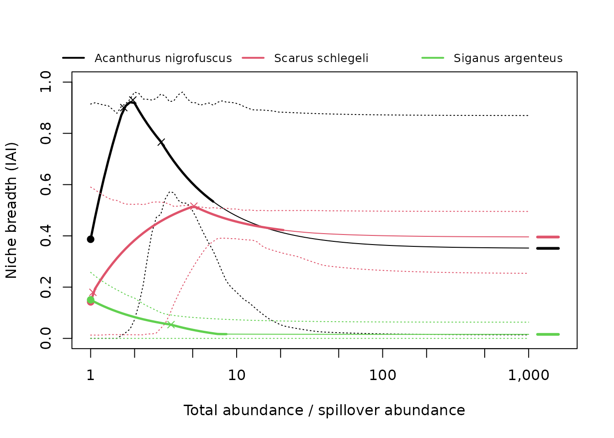

# The method: isodar-adjusted niche breadth

``` r

library(isoniche)
```

This vignette explains what **isoniche** computes. The method is
described in full by Granot, Dubiner & Belmaker (2026).

## Isodars

Under density-dependent habitat selection, individuals settle where
their expected fitness is highest. As a habitat fills up, its quality
declines, so later individuals settle in the next-best habitat (the
ideal free distribution; Fretwell & Lucas 1969). The densities in two
habitats at which fitness is equal form a line, the *isodar* (Morris
1987):

``` math
N_2 = a + b N_1 .
```

The intercept $`a`$ measures a density-independent preference: habitat 2
holds $`a`$ individuals before habitat 1 receives any. The slope $`b`$
measures how quickly habitat 2 fills compared with habitat 1 as total
abundance rises. A species without habitat preference has $`a = 0`$ and
$`b = 1`$.

Isodars are estimated from replicates (sites, or surveys) in which the
species’ densities in each habitat are known. Because both densities are
measured with error, they are fitted by total least squares (major-axis
regression), not by ordinary regression.

## Why abundance-based indices are biased

Whenever an intercept is not zero, the share of individuals in each
habitat changes with total abundance. A rare species keeps most
individuals in its preferred habitat and looks like a specialist; the
same species, when abundant, spills into other habitats and looks like a
generalist. A classic index, such as 1 - Gini of the habitat
proportions, therefore partly measures abundance:

``` r

set.seed(2)
sim <- simulate_isodars(slope1 = 1, slope2 = 1, int1 = 8, int2 = 8, noise = 1,
                        n = 60)
classic <- apply(as.matrix(sim[1:3]), 1, function(x) {
  x <- sort(x)
  n <- length(x)
  g <- 2 * sum(seq_len(n) * x) / (n * sum(x)) - (n + 1) / n
  (1 - g - 1 / n) * n / (n - 1)
})
plot(sim$total_abundance, classic, log = "x", pch = 19,
     xlab = "Total abundance at the site",
     ylab = "Classic niche breadth (1 - Gini)")
```



All sites come from one species with fixed habitat preferences, yet
niche breadth rises with abundance. Rarefaction (Cayuela et al. 2015)
removes the effect of sample size on observed habitat use, but not this
effect, which is part of how the species uses habitats.

## Pairwise isodars and the n-dimensional isodar

With $`H`$ habitats there are $`H(H-1)/2`$ pairwise isodars, fitted
separately, each with every site at which both habitats were sampled.
The examples use three species of `moorea_fish`, reef fish counts from
Moorea (BioTIME 2.0; Dornelas et al. 2025), as in the paper:

``` r

three <- c("Acanthurus nigrofuscus", "Scarus schlegeli", "Siganus argenteus")
fish3 <- moorea_fish[moorea_fish$species %in% three, ]
pw <- fit_isodars(fish3, species = "species", site = "site",
                  habitat = "habitat", abundance = "abundance")
pw$fit[[1]]
#> # A tibble: 3 × 7
#>   habitat_x    habitat_y     intercept  slope    sd n_sites flipped
#>   <chr>        <chr>             <dbl>  <dbl> <dbl>   <int> <lgl>  
#> 1 barrier_reef fringing_reef     0.553 0.916   59.3      13 FALSE  
#> 2 outer_slope  barrier_reef     49.6   0.265   66.9      13 TRUE   
#> 3 outer_slope  fringing_reef    86.6   0.0755  70.9      13 TRUE
```

The n-dimensional isodar is a *line* through habitat space, not a plane.
Equal fitness in $`H`$ habitats imposes $`H - 1`$ equalities, leaving
one degree of freedom: as total abundance changes, densities in all
habitats move together along one line. Its direction says how fast each
habitat fills as abundance rises (the analogue of the slopes), and where
it enters each habitat reflects density-independent preferences (the
analogue of the intercepts). The line is the first principal axis of the
site x habitat densities; `var_explained` is the share of variance it
accounts for.

``` r

ln <- fit_isodars(fish3, species = "species", site = "site",
                  habitat = "habitat", abundance = "abundance", dim = "ndim")
ln$fit[[3]]
#> n-dimensional isodar (line), method: pca | sites: 13 
#> Variance along the line: 0.996 
#> # A tibble: 3 × 3
#>   habitat        mean direction
#>   <chr>         <dbl>     <dbl>
#> 1 barrier_reef   1.08    0.0160
#> 2 fringing_reef 43       1.000 
#> 3 outer_slope    4.54   -0.0162
```

When some sites lack some habitats, the line is estimated with a
one-factor model that uses every site with at least two habitats
(`ndim_method = "latent"`, fitted with **glmmTMB**).

## The isodar-adjusted inequality

The *isodar-adjusted inequality* (IAI) allocates a chosen total
abundance $`T`$ among habitats as the isodars predict, and computes 1 -
Gini of that allocation, scaled to 0-1. For pairwise isodars the
allocation solves the isodar equations $`N_j - b N_i = a`$ by weighted
least squares subject to $`\sum N = T`$; habitats predicted negative are
set to 0 and the rest re-solved. By default each isodar is weighted by
its inverse variance, $`1 / (sd^2 (1 + b^2))`$ (`weights = "1/var"`).
For the line, the allocation is the point where the line meets
$`\sum N = T`$.

Two values summarise the IAI:

- **DI niche breadth**, at the *spillover abundance* $`T_0`$: the
  smallest total at which every used habitat holds at least one
  individual (per reference effort). It mainly reflects the intercepts.
- **DD niche breadth**, as $`T \to \infty`$, where only the slopes (the
  direction of the line) matter.

``` r

nb <- niche_breadth(fish3, species = "species", site = "site",
                    habitat = "habitat", abundance = "abundance",
                    n_boot = 199, seed = 1)
nb[c("species", "nb_di", "nb_di_lower", "nb_di_upper", "spillover_abundance",
     "nb_dd", "nb_dd_lower", "nb_dd_upper")]
#> # A tibble: 3 × 8
#>   species   nb_di nb_di_lower nb_di_upper spillover_abundance  nb_dd nb_dd_lower
#>   <chr>     <dbl>       <dbl>       <dbl>               <dbl>  <dbl>       <dbl>
#> 1 Acanthur… 0.468      0.0390       0.510                 133 0.365       0.0567
#> 2 Scarus s… 0.143      0.0470       0.664                  30 0.399       0.198 
#> 3 Siganus … 0.159      0.0479       0.651                  42 0.0102      0     
#> # ℹ 1 more variable: nb_dd_upper <dbl>
#> Abundances are per site (equal effort in every site and habitat).
```

Intervals come from resampling whole sites with replacement and
refitting the isodars. The density-dependent value can also be computed
at a given total (`dependent_at = 1000`, as in the paper) or at the
largest observed site total (`dependent_at = "max_observed"`).

## The niche breadth curve

Above $`T_0`$, until a habitat is clipped to zero, the allocation is
linear in $`T`$. If, in addition, no two habitats swap rank anywhere
above $`T_0`$,
``` math
NB(T) = NB_{DD} + (NB_{DI} - NB_{DD}) \frac{T_0}{T},
```
so niche breadth is halfway between the two values at $`T = 2T_0`$.
Where the predicted abundances of two habitats cross, the curve changes
course (it keeps the form $`A + B/T`$, with new constants, between
crossings); these *preference reversals* are reported, as are habitats
used at low density and abandoned at high density:

``` r

nb$abandoned
#> [1] ""            "outer_slope" "outer_slope"
nb$reversals[[1]]
#>   total_abundance     habitat_1    habitat_2 niche_breadth
#> 2        235.4562  barrier_reef  outer_slope     0.9759597
#> 3        244.3702 fringing_reef  outer_slope     0.9791916
#> 1        323.1334 fringing_reef barrier_reef     0.8452180
```

``` r

curve <- iai_curve(ln, n_boot = 99, seed = 1)
plot(curve, abundances = 1000, crossings = TRUE)
```



Plotting against abundance relative to $`T_0`$ puts all DI values at 1:

``` r

plot(curve, x_axis = "relative")
```



## Indices from isodar parameters (Appendix S1)

[`pairwise_niche()`](https://itai811.github.io/isoniche/reference/pairwise_niche.md)
summarises the pairwise isodars directly. An isodar can be written with
either habitat on the x-axis, so the indices are built to give the same
answer either way: slopes enter as $`(\log b)^2`$, because
$`\log(1/b) = -\log b`$, and intercepts as the perpendicular distance of
the isodar from the origin, $`d = |a| / \sqrt{1 + b^2}`$. The indices
are the inverse root-mean-square deviations from no preference,
$`1 / \sqrt{\sum w (\log b)^2 / \sum w}`$ for slopes and
$`1 / \sqrt{\sum w d^2 / \sum w}`$ for intercepts, and the weighted
means of $`|\log b|`$ and $`d`$. The intercept index is in abundance
units, so it depends on effort; the slope index does not.

``` r

pn <- pairwise_niche(pw$fit[[1]], weights = "1/var")
pn
#> Niche breadth from pairwise isodars (log scale)
#> # A tibble: 1 × 7
#>   mean_abs_log_slope mean_distance slope_niche_breadth intercept_niche_breadth
#>                <dbl>         <dbl>               <dbl>                   <dbl>
#> 1               1.18          39.6               0.640                  0.0188
#> # ℹ 3 more variables: n_isodars <int>, n_slope <int>, note <chr>
#> 1 cycle(s) of three habitats; 1 inconsistent (|log(product of slopes)| > 0.405); see $cycles
```

The isodars of three habitats should agree with each other: going round
the cycle A to B to C and back to A, the slopes multiply to 1. `$cycles`
gives this product for every set of three habitats, and flags it when it
departs from 1 by more than a factor of `exp(cycle_tolerance)` (default
1.5):

``` r

pn$cycles
#> # A tibble: 1 × 6
#>   habitat_1    habitat_2     habitat_3   product log_product inconsistent
#>   <chr>        <chr>         <chr>         <dbl>       <dbl> <lgl>       
#> 1 barrier_reef fringing_reef outer_slope    3.21        1.17 TRUE
```

The earlier, orientation-dependent indices (mean intercept and slope,
deviations $`(b - 1)^2`$ and $`a^2`$) are available with
`scale = "linear"`.

## Simulating data

[`simulate_isodars()`](https://itai811.github.io/isoniche/reference/simulate_isodars.md)
generates densities in any number of habitats from known isodars,
optionally with missing habitats, which is useful for checking the
method on a known answer:

``` r

set.seed(4)
sim <- simulate_isodars(2, 2, 0, 0, noise = 0.5, n = 60)
iai(fit_isodars(sim, hab_cols = c("hab1", "hab2", "hab3"), dim = "ndim"),
    abundances = 100)
#> # A tibble: 1 × 6
#>   total_abundance niche_breadth  hab1  hab2  hab3 note 
#>             <dbl>         <dbl> <dbl> <dbl> <dbl> <chr>
#> 1             100         0.571  14.3  28.6  57.1 ""
```

The true value for these isodars is 0.571.

## References

Cayuela, L., Gotelli, N. J. & Colwell, R. K. (2015). Ecological and
biogeographic null hypotheses for comparing rarefaction curves.
*Ecological Monographs*, 85, 437–455.

Dornelas, M., Antão, L. H., Bates, A. E. et al. (2025). BioTIME 2.0:
expanding and improving a database of biodiversity time series. *Global
Ecology and Biogeography*, 34(5), e70003.
<https://doi.org/10.1111/geb.70003>

Fretwell, S. D. & Lucas, H. L. (1969). On territorial behavior and other
factors influencing habitat distribution in birds. I. Theoretical
development. *Acta Biotheoretica*, 19, 16–36.

Granot, I., Dubiner, S. & Belmaker, J. (2026). Why abundance-based
indices of niche breadth are biased, and what can be done to improve
them. *Ecology Letters* (in revision). Itai Granot and Shahar Dubiner
contributed equally.

Morris, D. W. (1987). Spatial scale and the cost of density-dependent
habitat selection. *Evolutionary Ecology*, 1, 379–388.
